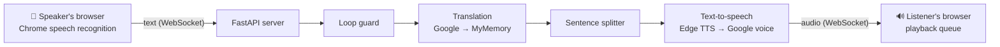

# AI Phone Interpreter

A real-time voice interpreter that lets two people who speak different languages talk to each other using two
devices (phones or laptops), even from different places.

Supported languages: **English, Telugu (తెలుగు), Tamil (தமிழ்) and Hindi (हिन्दी)**, in any pair.

## What it does

1. Each person opens the app in Chrome, enters the same session code and picks the language they speak.
2. Person A speaks. Their words appear live on both screens.
3. The sentence is translated into Person B's language.
4. Person B's device speaks the translation aloud, and both screens show the original text and the translation.
5. Person B replies, and the same happens in reverse.

## Features

- **Bidirectional voice translation** between any two of English, Telugu, Tamil and Hindi
- **Live transcripts** that appear while the person is still speaking
- **Spoken translations** with natural neural voices
- **Change language mid-call** from Settings
- **Works across locations:** both devices only need internet
- **Feedback-loop prevention:** mics pause while a translation plays, so the app never re-translates its own voice
- **Interrupt button:** stops playback on both devices and reopens the mics
- **Automatic fallback:** if one translation or voice service fails, the next one takes over, so the conversation doesn't stop
- **Latency shown per sentence:** translation time, voice time and time until the first audio plays
- **Connection and device status:** online/offline, speaking, playing, network round-trip time

## How it works



| Stage | What is used |
|---|---|
| Speech → text | Chrome Web Speech API in each user's browser (`en-IN`, `te-IN`, `ta-IN`, `hi-IN`) |
| Transport | WebSockets between the browsers and a FastAPI server |
| Translation | Google Translate (free endpoint), with MyMemory as fallback |
| Text → speech | Edge TTS neural voices (e.g. `te-IN-ShrutiNeural`), with the Google Translate voice and then the device's own voice as fallbacks |
| Playback | Web Audio API with an ordered queue; the first sentence plays while the rest are still being generated |

All of these services are **free and need no API keys**.

## Tech stack

- **Backend:** Python, FastAPI, WebSockets, Uvicorn, asyncio
- **Frontend:** HTML, CSS, JavaScript, Web Speech API, Web Audio API, AudioWorklet
- **Speech and language:** Chrome speech recognition, Google Translate, MyMemory, Edge TTS (`edge-tts`)
- **Testing:** Pytest, Playwright
- **Networking:** self-signed HTTPS for local devices, Cloudflare Tunnel for access from anywhere

## Run it

Requires Python 3.10+ and Google Chrome.

```bash
pip install -r requirements.txt
python run.py
```

On Windows, you can double-click `start.bat` instead.

- **Same Wi-Fi:** one device opens `http://localhost:8000`. The other opens the `https://<laptop-ip>:8443` address
  printed by the server, or scans the QR code. Accept the certificate warning once.
- **Different places:** run `cloudflared tunnel --url http://localhost:8000` and share the `https://…trycloudflare.com`
  link it prints. The link works while the computer and the tunnel are running.

**To start a call**
1. Both people open the link and enter the same session code.
2. Each picks their language under **"I speak"**.
3. One taps **Laptop**, the other taps **Phone**. These are just the two seats; either can be any device.
4. Tap the mic and talk. Pause briefly after each sentence.

## Project structure

```
run.py              starts the server
server/
  app.py            FastAPI app and WebSocket protocol
  session.py        sessions: two seats, each with its own language and ordered work queue
  pipeline.py       transcript → translation → sentences → speech → other device
  translate.py      Google / MyMemory translators with fallback
  tts.py            Edge TTS / Google voice / device voice with fallback
  loopguard.py      feedback-loop prevention
  sentences.py      sentence splitting (incl. Indic punctuation)
  latency.py        per-stage timing, median and p90
  vad.py            voice activity detection for server-side audio streaming
  selftest.py       live checks of the external services
static/             web UI (index.html, style.css, app.js, capture-worklet.js)
scripts/            HTTPS certificate, live service probe, WebSocket and browser end-to-end tests
tests/              pytest suite
```

## Testing

```bash
python -m pytest                    # 68 automated tests (no internet needed)
python scripts/stage1_probe.py      # checks the real translation and voice services
python scripts/e2e_browser.py       # two real Chrome browsers talking (needs Playwright)
```

The tests cover the translation and voice providers (against a local mock of their APIs), voice activity
detection, the loop guard, sentence splitting, latency stats and the full two-device WebSocket flow.
The browser test runs two Chrome instances and checks both directions, playback, the loop guard,
interrupt, and a Tamil ↔ Hindi conversation.

## Limitations

- Turn-based: speak, pause, then hear the translation, about 1–3 seconds later. Not simultaneous.
- The computer running the server must stay on. It is not yet deployed to a permanent host.
- The free translation and voice services are unofficial and can rate-limit. Fallbacks reduce the impact.

## Roadmap

- Deploy to a cloud host for a permanent link
- Installable mobile app (PWA) with accounts, contacts and incoming-call notifications
- Simultaneous interpretation with streaming recognition
- More Indian languages
