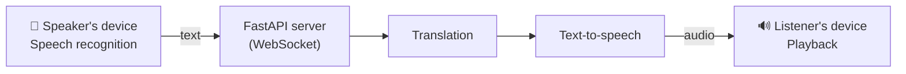

# 🌐 AI Phone Interpreter

A real-time voice interpreter that lets two people who speak different languages have a conversation using their own devices. One person speaks in their language, and the other hears it translated into theirs.

**Languages:** English · Telugu (తెలుగు) · Tamil (தமிழ்) · Hindi (हिन्दी), in any combination.

---

## 📌 Problem

In India, people often need to talk with someone who doesn't speak their language: at hospitals, offices, while travelling, or with family. Text translators are slow to use mid-conversation. This project makes it work like a normal conversation: **just speak, and the other person hears the translation.**

## 💡 Solution

Two people open the app on their phones or laptops, join the same session and choose their languages. When one person speaks:

1. The speech is converted to text on their device.
2. The text is translated into the other person's language.
3. The translation is converted to speech and played on the other person's device.
4. Both screens show the original sentence and its translation.

It works even when the two people are in **different locations**.

---

## ✨ Features

- 🔁 **Two-way voice translation** between English, Telugu, Tamil and Hindi
- 📝 **Live transcripts** that appear while the person is speaking
- 🔊 **Natural voices** for the translated speech
- 🌍 **Remote conversations:** both devices only need internet
- 🔄 **Change language during a call**
- 🛡️ **Echo / feedback-loop prevention:** mics pause while a translation is playing
- ⏹️ **Interrupt button** to stop playback instantly
- ⚡ **Automatic fallback:** if one service fails, the next one takes over
- ⏱️ **Latency shown for every sentence**
- 📶 **Device status:** online/offline, speaking, playing

---

## 🏗️ Architecture



| Step | Technology |
|---|---|
| Speech → Text | Chrome Web Speech API (runs in the browser) |
| Real-time communication | WebSockets (FastAPI) |
| Translation | Google Translate, with MyMemory as backup |
| Text → Speech | Edge TTS neural voices, with Google voice as backup |
| Audio playback | Web Audio API with an ordered playback queue |

All services used are **free and need no API keys**.

---

## 🛠️ Tech Stack

- **Backend:** Python, FastAPI, WebSockets, Uvicorn, asyncio
- **Frontend:** HTML, CSS, JavaScript, Web Speech API, Web Audio API
- **Speech & language:** Chrome Speech Recognition, Google Translate, MyMemory, Edge TTS
- **Testing:** Pytest, Playwright
- **Networking:** HTTPS, Cloudflare Tunnel

---

## 🚀 How to Run

**Requirements:** Python 3.10+ and Google Chrome

```bash
pip install -r requirements.txt
python run.py
```

On Windows, you can double-click `start.bat` instead.

**Connect from anywhere:**
```bash
cloudflared tunnel --url http://localhost:8000
```
Share the `https://….trycloudflare.com` link it prints.

**Start a conversation:**
1. Both people open the link in Chrome.
2. Enter the same **session code**.
3. Choose your language under **"I speak"**.
4. One person taps **Laptop**, the other taps **Phone**.
5. Tap the 🎤 mic and start talking.

---

## 📁 Project Structure

```
server/
  app.py          → FastAPI app & WebSocket handling
  session.py      → Session and device management
  pipeline.py     → Speech → Translation → Voice pipeline
  translate.py    → Translation services with fallback
  tts.py          → Text-to-speech services with fallback
  loopguard.py    → Echo / feedback-loop prevention
  sentences.py    → Sentence splitting
  latency.py      → Latency tracking
static/           → Web interface (HTML, CSS, JS)
tests/            → Automated tests
run.py            → Starts the server
```

---

## ✅ Testing

```bash
python -m pytest
```

- **68 automated tests** covering translation, text-to-speech, session handling, echo prevention and the full two-device WebSocket flow
- **Browser end-to-end tests** with two Chrome instances talking to each other, including Tamil ↔ Hindi

---

## ⚠️ Limitations

- Conversation is **turn-based**: speak, pause, then the translation plays (about 1–3 seconds)
- The computer running the server must stay on (not yet deployed to the cloud)
- The free services can sometimes rate-limit; fallbacks reduce the impact

## 🔮 Future Scope

- Cloud deployment with a permanent link
- Mobile app with contacts and incoming-call notifications
- Simultaneous (non-stop) interpretation
- More Indian languages
