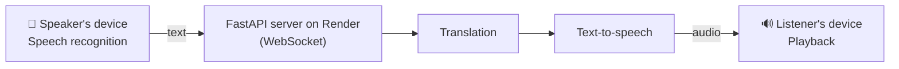

# 🌐 AI Phone Interpreter

A real-time voice interpreter that lets two people who speak different languages have a conversation using their own devices. One person speaks in their language, and the other hears it translated into theirs.

**Languages:** English · Telugu (తెలుగు) · Tamil (தமிழ்) · Hindi (हिन्दी), in any combination.

🔗 **Live demo:** https://YOUR-LINK.onrender.com
*(Hosted on Render's free tier. If it has been idle, the first load takes about a minute to wake up.)*

---

## 📌 Problem

In India, people often need to talk with someone who doesn't speak their language: at hospitals, offices, while travelling, or with family. Text translators are slow to use mid-conversation. This project makes it work like a normal conversation: **just speak, and the other person hears the translation.**

## 💡 Solution

Two people open the app on their phones or laptops, join the same session and choose their languages. When one person speaks:

1. The speech is converted to text on their device.
2. The text is translated into the other person's language.
3. The translation is converted to speech and played on the other person's device.
4. Both screens show the original sentence and its translation.

The app is deployed in the cloud, so the two people can be in **different locations** and only need internet.

---

## ✨ Features

- 🔁 **Two-way voice translation** between English, Telugu, Tamil and Hindi
- 📝 **Live transcripts** that appear while the person is speaking
- 🔊 **Natural voices** for the translated speech
- 🌍 **Remote conversations:** works from anywhere through the live link
- 🔄 **Change language during a call**
- 🛡️ **Echo / feedback-loop prevention:** mics pause while a translation is playing
- ⏹️ **Interrupt button** to stop playback instantly
- ⚡ **Automatic fallback:** if one service fails, the next one takes over
- ⏱️ **Latency shown for every sentence**
- 📶 **Device status:** online/offline, speaking, playing

---

## 🏗️ Architecture



| Step | Technology |
|---|---|
| Speech → Text | Chrome Web Speech API (runs in the browser) |
| Real-time communication | WebSockets (FastAPI) |
| Translation | Google Translate, with MyMemory as backup |
| Text → Speech | Edge TTS neural voices, with Google voice as backup |
| Audio playback | Web Audio API with an ordered playback queue |
| Hosting | Render (cloud), auto-deployed from GitHub |

All services used are **free and need no API keys**.

---

## 🛠️ Tech Stack

- **Backend:** Python, FastAPI, WebSockets, Uvicorn, asyncio
- **Frontend:** HTML, CSS, JavaScript, Web Speech API, Web Audio API
- **Speech & language:** Chrome Speech Recognition, Google Translate, MyMemory, Edge TTS
- **Deployment:** Render (continuous deployment from GitHub)
- **Testing:** Pytest, Playwright

---

## 🚀 How to Use

1. Open the **live demo link** in Google Chrome, on both devices.
2. Enter the same **session code** on both.
3. Choose your language under **"I speak"**.
4. One person taps **Laptop**, the other taps **Phone**. These are just the two seats; either can be any device.
5. Allow the microphone, tap the 🎤 mic and start talking. Pause briefly after each sentence.

## 💻 Run Locally

**Requirements:** Python 3.10+ and Google Chrome

```bash
pip install -r requirements.txt
python run.py
```

Then open `http://localhost:8000`.

---

## 📁 Project Structure

```
server/
  app.py          → FastAPI app & WebSocket handling
  session.py      → Session and device management
  pipeline.py     → Speech → Translation → Voice pipeline
  translate.py    → Translation services with fallback
  tts.py          → Text-to-speech services with fallback
  loopguard.py    → Echo / feedback-loop prevention
  sentences.py    → Sentence splitting
  latency.py      → Latency tracking
static/           → Web interface (HTML, CSS, JS)
tests/            → Automated tests
run.py            → Starts the server
render.yaml       → Render deployment config
```

---

## ✅ Testing

```bash
python -m pytest
```

- **68 automated tests** covering translation, text-to-speech, session handling, echo prevention and the full two-device WebSocket flow
- **Browser end-to-end tests** with two Chrome instances talking to each other, including Tamil ↔ Hindi

---

## ⚠️ Limitations

- Conversation is **turn-based**: speak, pause, then the translation plays (about 1–3 seconds)
- On the free hosting tier, the app **sleeps after 15 minutes idle** and takes about a minute to wake up
- The free translation and voice services can sometimes rate-limit; fallbacks reduce the impact
- Speech recognition needs **Google Chrome**

## 🔮 Future Scope

- Mobile app with contacts and incoming-call notifications
- Simultaneous (non-stop) interpretation
- More Indian languages
