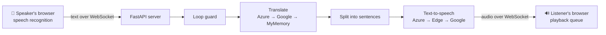

# AI Phone Interpreter

**Real-time voice translation between two people on two devices**, in English, Telugu (తెలుగు), Tamil (தமிழ்) and Hindi (हिन्दी).

Each person opens the app in their browser and picks the language they speak. When one person talks, the other
hears the translation spoken aloud in their own language, and both see the live transcript and the translation on screen.
The two devices can be phones or laptops, and they can be in different places.

## Features

- **Any language pair:** English, Telugu, Tamil and Hindi, in any combination (for example Telugu ⇄ Tamil). The language can be changed during a call.
- **Live transcripts:** words appear on both screens while the speaker is still talking.
- **Spoken translation:** natural neural voices, played on the listener's device.
- **Works without paid APIs:** every stage has free providers, with automatic fallback when one fails.
- **Feedback-loop protection:** mics pause while a translation is playing, so the app never translates its own voice.
- **Interrupt:** one tap stops playback on both devices and reopens the mics.
- **Latency display:** each sentence shows recognition, translation, voice and time-to-first-audio.
- **Self-test:** checks every real cloud provider and reports what works (`/api/selftest`).

## How it works



1. The speaker's browser turns speech into text, using Chrome's built-in recognition (`en-IN`, `te-IN`, `ta-IN` or `hi-IN`).
2. The server translates the text into the **listener's** language.
3. The translation is split into sentences and turned into speech. The first sentence plays while the rest are still being generated.
4. The listener's browser plays the audio in order, and both screens update.

Every stage tries providers in order and falls back automatically:

| Stage | Providers, in order |
|---|---|
| Speech → text | Chrome Web Speech API (free) · Azure Speech (optional, server-side) |
| Translation | Azure AI Translator (if key) → Google free endpoint → MyMemory |
| Text → speech | Azure neural voices (if key) → Edge TTS neural voices → Google Translate voice → device's built-in voice |

> Edge TTS, the Google voice and the Google translation endpoint are free and need no account, but they are
> **unofficial** services that may rate-limit or change. That is why each stage has a fallback.

## Tech stack

**Backend:** Python, FastAPI, WebSockets, Uvicorn
**Frontend:** HTML, CSS, JavaScript (no framework), Web Speech API, Web Audio API, AudioWorklet
**Speech and translation:** Azure Speech, Azure AI Translator, Edge TTS, Google Translate, MyMemory, ElevenLabs (optional)
**Testing:** Pytest, Playwright

## Quick start

Requires **Python 3.10+** and **Google Chrome** on both devices.

```bash
pip install -r requirements.txt
python run.py
```

On Windows you can double-click **`start.bat`** instead.

**Same Wi-Fi**
- **Device 1:** open `http://localhost:8000`.
- **Device 2:** open the `https://<laptop-ip>:8443` address printed by the server, or scan the QR code on device 1's screen.
  Accept the browser's certificate warning once (**Advanced → Proceed**).

**Different places, a quick temporary link**
```bash
cloudflared tunnel --url http://localhost:8000
```
Share the printed `https://….trycloudflare.com` link. It works only while your computer and the tunnel are running.

**Joining a call**
1. Both people open the link and enter the **same session code**.
2. Each picks their language under **"I speak"**.
3. One person taps **Laptop**, the other taps **Phone**. These are just the two seats; either can be any device.
4. Tap the mic and talk. Pause briefly after each sentence.

## Deploy (permanent link)

The repository includes `render.yaml` for [Render](https://render.com):

1. **New → Blueprint** → select this repository → **Apply**.
2. Open the URL Render gives you. Real HTTPS works from anywhere, with no certificate warning.

For other hosts, use `pip install -r requirements.txt` as the build command and `python run.py --cloud` as the start command.
The server listens on `$PORT`. Render's free tier sleeps after 15 idle minutes, so open the link a few minutes before a demo.

## Configuration

Everything is optional. With no configuration the app uses only the free providers.
Copy `.env.example` to `.env` to add keys. **Never commit `.env`.**

| Variable | Purpose |
|---|---|
| `AZURE_SPEECH_KEY`, `AZURE_SPEECH_REGION` | Azure neural voices and server-side speech recognition |
| `AZURE_TRANSLATOR_KEY`, `AZURE_TRANSLATOR_REGION` | Azure translation (leave the region empty for a *Global* resource) |
| `TRANSLATE_PROVIDER` | `auto`, or an ordered list such as `google_free,mymemory` |
| `TTS_PROVIDER` | `auto`, or an ordered list such as `edge,google,browser` |
| `MYMEMORY_EMAIL` | Raises MyMemory's free quota from 5k to 50k characters a day |
| `ELEVENLABS_API_KEY`, `ELEVENLABS_VOICE` | Optional ElevenLabs voice (`eleven_v3` supports Telugu) |

Check which providers work with your setup:
```bash
python scripts/stage1_probe.py --translator-diagnose
```

## Project structure

```
run.py                 start the server (local: HTTP + HTTPS; cloud: single $PORT)
server/
  app.py               FastAPI routes + WebSocket protocol
  session.py           sessions, two seats, per-speaker ordered queues
  pipeline.py          recognise → translate → split → speak → deliver; interrupts; latency
  translate.py         Azure / Google / MyMemory translators + fallback chain
  tts.py               Azure / Edge / Google / ElevenLabs / browser voices + fallback chain
  stt.py               Azure speech-to-text (server mode)
  vad.py               voice activity detection for streamed audio
  loopguard.py         feedback-loop prevention
  sentences.py         sentence splitting (incl. Indic punctuation)
  latency.py           per-stage timing, median / p90
  selftest.py          live provider checks
static/                browser UI (index.html, style.css, app.js, capture-worklet.js)
scripts/               HTTPS certificate, provider probe, WebSocket smoke test, browser e2e test
tests/                 pytest suite
```

## Testing

```bash
python -m pytest                  # 68 offline tests (no internet or keys needed)
python scripts/ws_smoke.py        # two simulated devices against a running server
python scripts/e2e_browser.py     # two real Chromium browsers, incl. fake microphone (needs Playwright)
```

The offline tests check the real provider code against a local server that imitates the Azure, Google and MyMemory
APIs. They also cover voice detection, the loop guard, sentence splitting, configuration and the full WebSocket protocol.

## Limitations

- **Turn-based, not simultaneous:** speak, pause, then hear the translation (about 1–3 s).
- **Local mode needs a running computer:** for a link that works with your computer off, deploy it.
- **Free providers are unofficial:** they can rate-limit, and a shared network such as a campus can hit limits sooner.
- **Browser speech recognition** needs Chrome or Edge and an internet connection.

## Roadmap

- Installable app (PWA), accounts and contacts, and incoming-call notifications
- Simultaneous interpretation using streaming recognition
- More Indian languages
